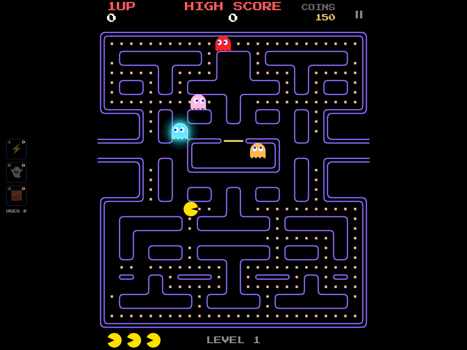
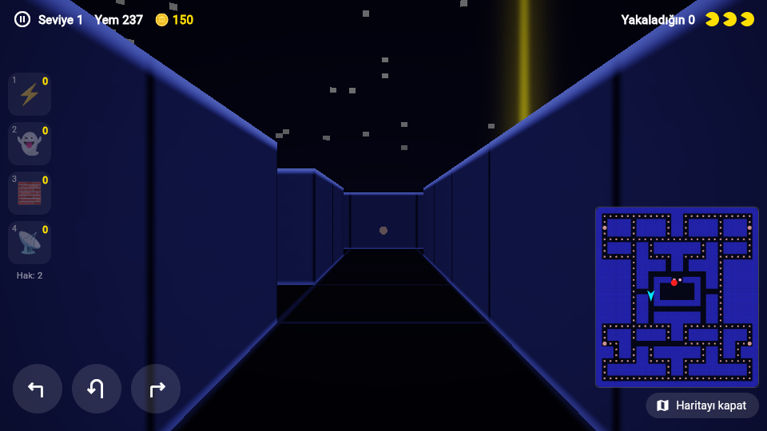
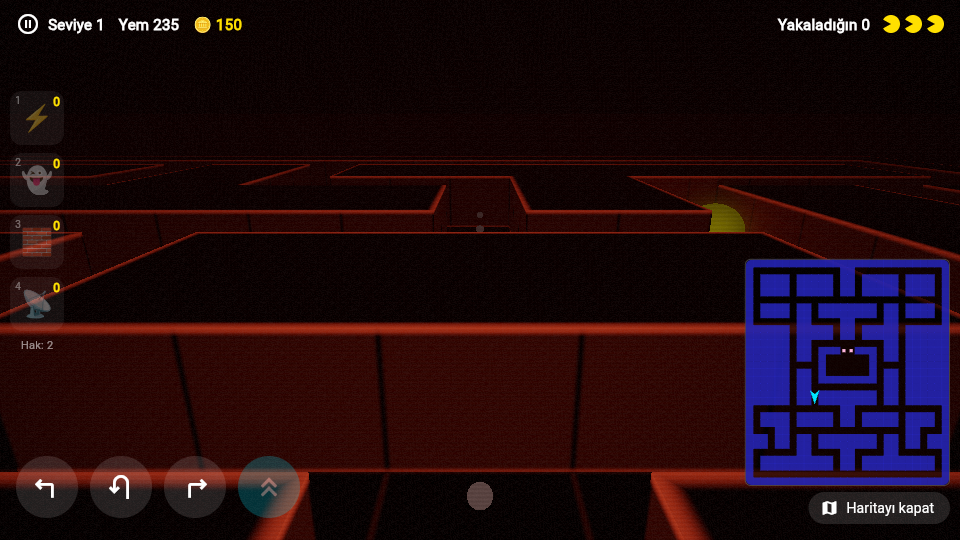

# 👻 Ghost Hunt

**Reverse Pac-Man.** This time you are the ghost. Pac-Man runs through the maze eating pellets, and your job is to catch him before he clears the board.

Your ghost glows neon cyan, so you always know which one is you.

▶️ **Play in your browser:** https://erenmeren.github.io/ghost-hunt/

| Easy | Hard | Hell, mid-jump |
|---|---|---|
|  |  |  |

## Modes

| Mode | What it feels like |
|------|--------------------|
| **Easy** | The classic arcade view. The whole maze is on screen. |
| **Hard** | You see through the ghost's eyes. It's dark; follow Pac-Man's yellow glow and the sound of him eating. |
| **Hell** | Red, dark and flickering. Sound is your only guide. Jump to peek over the walls. |

- Pac-Man has 3 lives. Take them all with the other ghosts and you win. If he eats every pellet, he wins.
- Watch out: after a power pellet, Pac-Man turns around and hunts you.
- Every level, Pac-Man gets faster and smarter.

## Coins and the shop

Coins are earned only by playing. Nothing is sold for real money.

- Catch Pac-Man yourself for the biggest reward. The sooner, the more.
- Harder modes pay more.
- Spend coins on short power-ups (speed, invisibility, passing through walls, sonar) and permanent upgrades.

## Controls

| | Keyboard | Phone |
|---|---|---|
| Turn | ← → | Swipe or the turn buttons |
| Turn back | ↓ | Swipe down |
| Jump (Hell) | Space | Jump button |
| Use a power-up | 1–4 | Buttons on the left |
| Map | M | Button in the corner |
| Pause | P / Esc | ⏸ |

## Coming next: Ghost Hunt: Neon

A bigger, longer story is on the way.

One stormy midnight, lightning strikes a closed-down arcade. The machines flicker on and their characters wake up. Pac-Man escapes into the wires, jumping from machine to machine through the wall sockets, and only one ghost can follow him: **Neon**.

Every cabinet in the arcade is a different game, and every power pellet Pac-Man eats brings a dangerous new twist.

## License

[Apache License 2.0](LICENSE)
